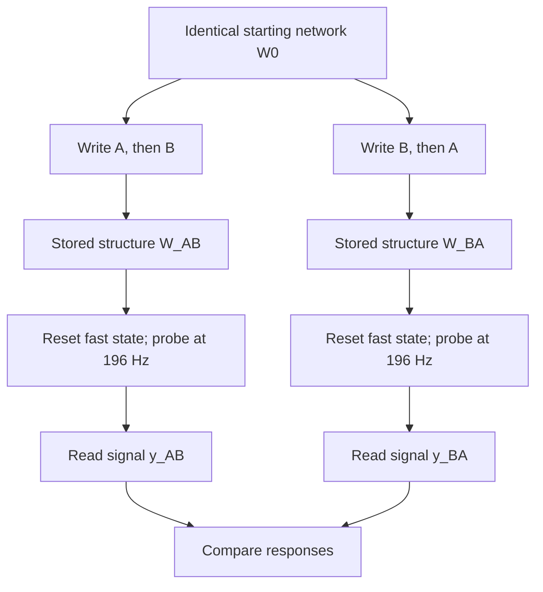
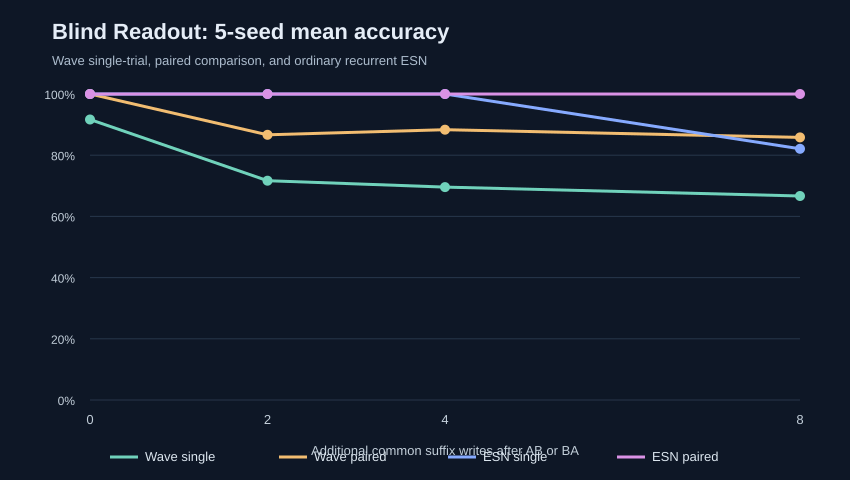
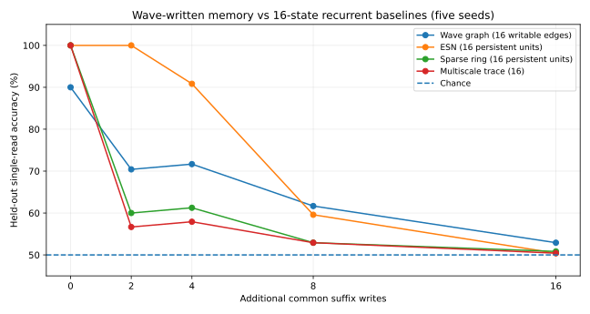

# Slider V3 — Wave-Written Graph Memory

**Can the history of waves become a lasting change in a network, and can a later wave read that history back?**


Slider V3 is a small, offline, reproducible experiment in **history-dependent wave propagation**. Eight damped oscillators are connected by 16 writable edges. A stimulus sends a sine-wave pulse into the graph; the motion measured *inside the graph* changes its edge weights. The next pulse therefore travels through a network changed by previous pulses.

The central result is modest but real: presenting the same two stimuli in opposite orders (**AB** versus **BA**) leaves different connection matrices and produces different responses to an identical, later, **non-writing** probe — even after the fast oscillator state has been reset.

> **The memory is in the altered connections, not in the beautiful 3D trace and not in a secret A/B lookup table.** This is a designed synthetic wave-and-plasticity model, not a demonstration of general intelligence, novel physics, or a useful large-capacity memory system.

## Run it

Requires Python 3.10+ with Tkinter (normally included on Windows) and NumPy/Matplotlib.

```powershell
python3.13 -m pip install numpy matplotlib
python3.13 SliderWaveMemoryV3.py
```

In the app:

1. Select **Mode C — wave-written graph memory**.
2. Click **COMPARE A–B vs B–A**, then **COMPARE A–B–X vs B–A–X**.
3. Use the **right-hand scrollbar** to view the result details and log.
4. Switch the **matrix write law** between **fourier** and **strain**.
5. Turn off **Learning enabled**, or **erase W**, to check that the order difference disappears.

The script is named **SliderWaveMemoryV3.py** in this repository (including capitalization).

For automated, headless checks:

```powershell
python3.13 SliderWaveMemoryV3.py --selftest
python3.13 SliderWaveMemoryV3.py --demo
```

No audio device, cloud service, GPU, or internet access is needed.

## The measured result

The repository's deterministic demo produces the following readings using the default Fourier write rule and default parameters:

| Mode | Histories | Matrix difference, $\lVert \Delta W\rVert_F$ | Probe RMS difference | Relative probe difference |
|:---|:---|---:|---:|---:|
| A — phase oscillator | AB / BA | 0.000000 | 0.000000 | 0.000% |
| A — phase oscillator | ABX / BAX | 0.000000 | 0.000000 | 0.000% |
| B — bounded feedback | AB / BA | 0.000000 | 0.000000 | 0.000% |
| B — bounded feedback | ABX / BAX | 0.000000 | 0.000000 | 0.000% |
| **C — writable wave graph** | **AB / BA** | **0.019438** | **0.002410** | **2.890%** |
| **C — writable wave graph** | **ABX / BAX** | **0.019905** | **0.002147** | **2.612%** |

The relative difference is the RMS of the difference between the two probe signals, divided by the root-mean-square of their two individual mean-square powers:

$$
d_{\mathrm{rel}} =
\frac{\mathrm{RMS}(y_1-y_2)}
{\sqrt{\bigl(\mathrm{RMS}(y_1)^2+\mathrm{RMS}(y_2)^2\bigr)/2}}.
$$

The reported percentage is $100d_{\mathrm{rel}}$. It is **not** an accuracy score or a measured probability of recalling a sequence.

In each paired trial, both histories begin with the **same initial graph**. Before their final probe, all fast oscillator variables, phases, sample clocks, and short-term output histories are reset. Only the altered edge weights remain. The probe itself does **not** update the edges.

The **ABX / BAX** result means an additional common **X** write does not immediately erase the earlier order distinction in this test. It does not establish indefinite retention.

Full recorded output: [slider_wave_memory_lab_v3_results.txt](slider_wave_memory_lab_v3_results.txt).

## How it works

### 1. A wave is an input, not an assigned memory pattern

Three stimulus labels choose only a drive frequency and injection node:

| Input | Frequency | Injection node |
|:---|---:|---:|
| A | 160 Hz | 0 |
| B | 230 Hz | 3 |
| X | 310 Hz | 5 |
| Common read probe | 196 Hz | 6 |

The graph has eight nodes, with nearest-neighbor ring links and next-nearest-neighbor links (16 undirected edges). Its dynamics are synthetic discrete-time coupled oscillators. For displacement vector $x_t$, the actual implemented step is:

$$
x_{t+1} =
1.975x_t - 0.975x_{t-1}
-0.15x_t
-0.87\bigl(D(W)-W\bigr)x_t
+u_t.
$$

Here $W$ is the symmetric connection matrix, $D(W)$ contains its row sums on the diagonal, and $u_t$ is the externally driven pulse at one node. The graph is integrated through time; it is not fed a precomputed weight-change stencil.

### 2. Measure what the wave actually did

For each pulse of length $T$, the default **fourier** rule measures a complex, Hann-windowed coefficient at the *drive frequency* $f$ for every node:

$$
F_i(f) =
\frac{2}{\sum_{t=0}^{T-1}h_t}
\sum_{t=0}^{T-1}
h_t\,x_i(t)\,
e^{-2\pi \mathrm{i}ft/f_s},
$$

where $h_t$ is the Hann window and the simulation sample rate is $f_s=2400$ steps per second.

Unlike a comparison of magnitudes alone, the complex difference $F_i-F_j$ depends on **relative phase as well as amplitude**. For each existing edge $(i,j)$, its measured exposure is:

$$
E_{ij}
=0.48\,\tanh\left(\frac{|F_i-F_j|^2}{0.25}\right).
$$

The optional **strain** rule instead uses the time-average of squared differences in node displacement:

$$
E_{ij}^{\mathrm{strain}}
=\frac1T\sum_{t=0}^{T-1}
\bigl(x_i(t)-x_j(t)\bigr)^2.
$$

Both rules are defined by the experimenter. **Phase sensitivity is present in the Fourier rule; this experiment does not show that phase is uniquely necessary for order memory.**

### 3. The measured response writes the graph

Connected weights are updated symmetrically using the measured exposure:

$$
W_{ij}^{\mathrm{new}}
=\mathrm{clip}\left(
W_{ij}^{\mathrm{old}}+
\eta s\,E_{ij},\ 0.01,\ 0.70
\right).
$$

Here $\eta=0.055$ is the default write rate and $s=1$ the default strength. Unconnected edges are not added. The fast wave state is reset between stimulus events, so the next event's response depends on the retained network $W$, not on a leftover oscillation from the previous event.

Let $T_A(W)$ mean *propagate A through the current graph, measure the response, then update that graph*. Then, for this implementation:

$$
T_B\bigl(T_A(W_0)\bigr)
\ne
T_A\bigl(T_B(W_0)\bigr).
$$

This is the precise sense in which the **write operations are order-dependent (noncommuting)**. It is **not** a claim that the matrices $W_A$ and $W_B$ themselves have a nonzero matrix commutator.

### 4. Ask the same question of two different histories

After AB and BA, reset the fast state and apply the **same 196 Hz non-writing probe**. The observed signal is a fixed, normalized linear mixture of node displacements:

$$
y_t=r^\mathsf{T}x_t.
$$

Because the graph is different, the probe's wave propagation — and therefore the readout — can be different. The experiment observes **a distinction between histories**, not a reconstructed transcript of the original events.



## Controls: why this is not V2's lookup-table shortcut

**V2** could stamp a prescribed hardcoded pattern into a matrix when A or B was selected. **V3 does not do that.** Its labels choose a sine input and a location; edge changes come from the integrated network's measured motion.

The headless self-tests check these distinct explanations:

| Control | Outcome | What it tests |
|:---|:---|:---|
| Mode A or B | No persistent AB/BA read difference after reset | Phase continuity or bounded feedback alone is not the stored structural memory in this paired test |
| Learning disabled | No persistent order difference | Writing is necessary |
| Erase the matrix after writing | No order difference | The final read depends on retained $W$ |
| Force both writing wavefields through unchanged $W_0$ | No order difference | Exposure must be affected by previous writes; two fixed, additive exposures commute |
| Reset fast state before read | Read difference remains in C | It is not an unreset oscillator phase |
| Repeat the same read | Identical result, unchanged matrix | Reads do not secretly write |
| Fourier and strain self-tests | Pass | Both implemented wave-derived write laws are numerically exercised |

The **fixed-propagation** control is particularly informative: it still computes real simulated wave exposure, but computes both writes against the *same unchanged propagation graph*. Without response-to-previous-write feedback, order memory disappears. The causal loop is:

**wave → measured exposure → altered connections → changed next wave → changed next write.**

## What the plots are (and are not)

- **3D trace:** a visualization of samples from the last three output buffers. Its shape alone is **not proof of memory**.
- **Matrix heat map:** the current edges, or the difference between two final edge matrices in a comparison.
- **Paired probe traces:** the same read applied after different histories, with fast states reset.

**Display noise is only added to the live visualization.** The paired comparison is deterministic and noise-free. Its reported 2.890% and 2.612% differences therefore do **not** establish robust retrieval under noise.

## Connection to the wider experiments

This is one concrete step in a longer investigation:

- [FourierFlower](https://github.com/anttiluode/FourierFlower): structured periodic relationships and phase geometry.
- [Friday](https://github.com/anttiluode/Friday): exact hidden modes in a graph, the difference between *information existing* and *information being observable*, and how changing internal coupling may make hidden states accessible.
- [SelfIndexingBeach](https://github.com/anttiluode/SelfIndexingBeach) and [ComputingBeachClaude](https://github.com/anttiluode/ComputingBeachClaude): writable wave media whose altered material properties change later responses to weak probes.

**Friday asks: what information can a probe reach? Slider V3 asks: can the probe-relevant structure itself be written by prior wave histories?** They are related questions, but these are not yet one combined system. V3 has not demonstrated Friday's protected hidden modes or selective access to them.

The shared research question is:

> **Can a physical-style medium retain distinctions between histories in its internal relationships, and later reveal the right distinctions through controlled, non-destructive probing?**

## Blind readout benchmark — now tested

We ran the proposed experiment. The classifier receives **only 128 fixed samples of a later, non-writing waveform**. It does not inspect the edge matrix, and all fast oscillator state is reset before the probe. Training labels say whether the write history began with **AB** or **BA**; each matched pair receives the *same* initial graph and *same* common suffix. For suffix lengths above zero, the test suffix strings are **absent from training**. Starting edge weights also receive independent perturbations in each pair (Gaussian standard deviation 0.002).

Five independent seeded runs (20261106–20261110) used **48 training pairs and 24 test pairs per seed**:

| Extra common writes | Wave single read | Wave matched-pair choice | Conventional ESN single |
|---:|---:|---:|---:|
| 0 | **91.7%** | 100.0% | 100.0% |
| 2 | **71.7%** | 86.7% | 100.0% |
| 4 | **69.6%** | 88.3% | 100.0% |
| 8 | **66.7%** | 85.8% | 82.1% |



**Single read** means classifying *one waveform*, with no matched comparison supplied at test time. **Matched-pair choice** is the easier task of receiving both responses and identifying which came from AB. They should not be confused.

At a suffix length of 2, the wave single-read accuracy across seeds fell from **71.7%** clean to **62.5%** under 1% Gaussian measurement noise (relative to clean probe RMS), **61.3%** under 3% noise, and **53.3%** at 10% noise. The 196 Hz/node 6, 160 Hz/node 1 and 310 Hz/node 4 read probes produced different outcomes, demonstrating that **probe choice matters** for readability.

Crucially, the **learning-disabled, erased, and fixed-propagation controls** returned to **50% single-read and matched-pair chance**. The fixed-propagation signals are identical to numerical precision; insignificant floating-point rounding is treated as a tie. Labels shuffled for training produce a further negative control.

The conventional baseline is a **96-unit tanh echo-state network (ESN)** with fixed recurrent connections and a trained linear readout. **It outperformed the wave system** in the tested conditions. Its access to persistent recurrent state is different from the wave system's reset-and-probe protocol, so this is context, not a cost-matched physical comparison. The current evidence is for **partial, decodable synthetic order memory**, not a memory architecture advantage.

Run locally:

```powershell
python3.13 blind_readout_benchmark.py --selftest
python3.13 blind_readout_benchmark.py
foreach ($s in 20261106..20261110) { python3.13 blind_readout_benchmark.py --seed $s --out ("seed_" + $s) }
```

The benchmark requires NumPy, plus optional Matplotlib for a plot. If Numba is installed it accelerates the timestepper and **first checks its agreement** with the original simulator. Otherwise it runs the reference implementation.

Read the [five-seed report](MULTISEED_RESULTS.md), [single-seed detailed report](BLIND_READOUT_RESULTS.md), [full data](blind_readout_multiseed.json) and [source code](blind_readout_benchmark.py).

## Resource-matched memory comparison — measured

The earlier **96-unit ESN** was not budget-matched: it directly exposed its state, while the wave medium retained just **16 writable edge weights** and was interrogated by a wave probe. We have now compared models with **16 persistent mutable scalars**, the same AB/BA + held-out suffix datasets, the same 128-sample scalar non-writing readout *count*, and the same linear ridge decoder. Controls include an **8-state ESN**, **16-state sparse recurrent ring**, **16-state exponential trace bank**, commutative bag-of-inputs null, and **32-state ESN**.

Five seeds, 48 training and 24 held-out matched pairs per seed:

| Additional common writes | Wave (16 edges) | Sparse ring (16) | Dense ESN (16) | Multiscale trace (16) |
|---:|---:|---:|---:|---:|
| 0 | 90.0% | 100.0% | 100.0% | 100.0% |
| 2 | 70.4% | 60.0% | **100.0%** | 56.7% |
| 4 | 71.7% | 61.3% | **90.8%** | 57.9% |
| 8 | 61.7% | 52.9% | 59.6% | 52.9% |
| 16 | 52.9% | 50.8% | 50.4% | 50.4% |



**Interpretation:** on this particular binary order-recall task, the ordinary **16-state dense ESN is substantially more accurate** at short-to-medium retention lengths. The wave approach beats the simple sparse-ring and multiscale-trace baselines at some lengths, and has a small advantage over the dense ESN at eight additional writes; the latter is not established as statistically reliable. By sixteen writes, every model is near chance.

**What was and wasn't matched:** the number of persistent *mutable scalar slots*, held-out sequences, decoder, and **128 scalar observations**. The sensor hardware is not identical: ESN states drive a fixed idealized frequency-multiplexed one-dimensional transducer, while the wave system is interrogated with a 196 Hz probe through its current graph. The dense ESN also uses more *fixed* recurrent coefficients. Computing costs are **not equal**: with two suffix events, the wave simulation performs **1,536 steps per write plus 1,024 read steps** (approximately **458,752 dense-matvec multiply-add lower-bound operations**), while the ESN16 needs one state update per event plus the analytic 128-sample read (~**3,072** corresponding operations). These arithmetic counts are model-work proxies, not energy or hardware measurements. Matching a cost *ceiling* does not mean both systems need to spend all of it.

**Conclusion:** we have not demonstrated a performance, computational, or energy advantage for V3 over ordinary recurrent memory. What remains distinctive is the *mechanism* — structural wave-derived writes with separate non-writing wave interrogation — rather than benchmark superiority.

Run the benchmark locally:

```powershell
python3.13 resource_matched_benchmark.py --selftest
python3.13 resource_matched_benchmark.py
```

The optional Numba implementation is validated against the original wave simulator before acceleration; no GPU or server is required. Full details: [resource-matched report](RESOURCE_MATCHED_RESULTS.md), [complete five-seed JSON](resource_matched_results.json), and [reproducible source](resource_matched_benchmark.py).

### Next questions

The next genuinely discriminating tests are **multi-bit storage capacity**, robustness to much larger disturbances, and an equal-*transducer* experiment. Simple AB/BA classification is not a capacity measurement. It remains possible that this particular wave-plasticity rule offers no practical advantage.

## Scope and limits

This is **not** an AI that discovered its own plasticity law, a quantum computer, a proof of a special property of $\pi$, or a demonstrated improvement over ordinary neural/recurrent architectures. Frequencies, topology, drive ports, coupling dynamics, and write law were deliberately chosen. Readout is a synthetic fixed mixture, not real microphone data. There is no established large-scale storage capacity, long-term robustness, end-to-end task-trained plasticity, or advantage over recurrent architectures.

**What is supported:** in this eight-node system, measured wave motion can modify the network so that opposite input orders leave different structural states and different later non-writing responses; the existing controls isolate this effect from fast phase carry-over and hardcoded label-to-matrix assignments.

## Repository files

- [SliderWaveMemoryV3.py](SliderWaveMemoryV3.py) — GUI, wave simulator, comparisons, and self-tests.
- [slider_wave_memory_lab_v3_results.txt](slider_wave_memory_lab_v3_results.txt) — saved numerical demo output.
- [blind_readout_benchmark.py](blind_readout_benchmark.py) — blind classification benchmark and reproducible controls.
- [MULTISEED_RESULTS.md](MULTISEED_RESULTS.md) — five-seed results and protocol.
- [BLIND_READOUT_RESULTS.md](BLIND_READOUT_RESULTS.md) and [blind_readout_multiseed.json](blind_readout_multiseed.json) — detailed measurements and machine-readable scores.
- [blind_readout_multiseed.svg](blind_readout_multiseed.svg) — measured accuracy plot.
- [pic.png](pic.png) — interface screenshot.

All math above uses **GitHub-supported Markdown math** and the process diagram uses **GitHub-supported Mermaid**. View this file on GitHub to see them rendered.
