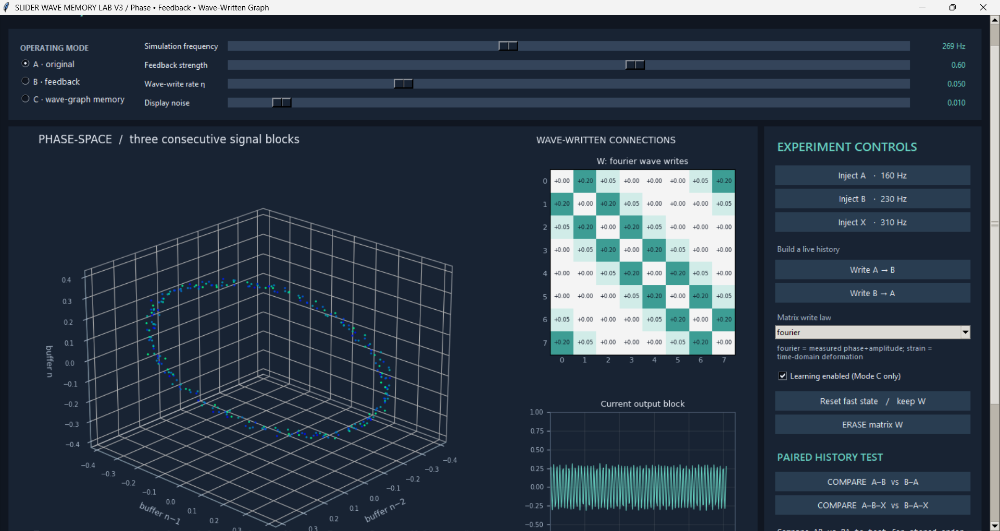

SLIDER / WAVE MEMORY LAB V3
============================

WHAT THIS CHANGES
-----------------
This version does NOT write a hardcoded INPUT_PATTERNS[A/B] matrix imprint.
A/B/X specify only which synthetic sine stimulus (frequency and injection node)
is applied to an eight-node damped, coupled wave system.

Each event is generated by integrating the current physical network. The complex
single-frequency Fourier coefficient F_i of each node's simulated motion is
measured over that pulse (with a Hann window):

   F_i = 2/sum(h_t) * sum_t [ h_t * x_i(t) * exp(-i * 2*pi*f*t/fs) ]

With "fourier" selected, connected edges are updated:

   exposure_ij = 0.48 * tanh( |F_i - F_j|^2 / 0.25 )
   W_ij <- clip(W_ij + eta * strength * exposure_ij, 0.01, 0.70)

Complex differences respond to relative PHASE as well as AMPLITUDE.
With "strain" selected, the exposure is instead the time-averaged squared
relative displacement between adjacent node states.

After an A write, B propagates through the newly modified network. The changed
response produces a different subsequent write. AB and BA need not commute.

START ON WINDOWS
----------------
1. Install Python 3.10+ (Tkinter is normally included with Windows Python).
2. Install dependencies:
      python3.13 -m pip install numpy matplotlib
3. Run:
      python3.13 slider_wave_memory_lab_v3.py
4. Choose Mode C and click "COMPARE A-B vs B-A".
5. Scroll using the RIGHT scrollbar to reach result details and the log.
6. Switch the matrix write law between fourier and strain to compare.
7. Disable learning or erase W to see the order effect disappear.

HEADLESS AUDIT
--------------
    python3.13 slider_wave_memory_lab_v3.py --selftest
    python3.13 slider_wave_memory_lab_v3.py --demo

The tests check:
 - no lasting AB/BA difference in phase-only or bounded-feedback modes;
 - AB/BA and ABX/BAX produce different W and later nonwriting signals in C;
 - all fast state and oscillator phase are reset before the paired read;
 - disabling learning or erasing W eliminates the effect;
 - when both event wavefields are FORCED through the unchanged W0,
   additive writes commute and order information disappears;
 - identical reads are repeatable and never modify W;
 - complex Fourier features match the actual write-law implementation.

WHAT THIS DOES NOT PROVE
------------------------
This is a deliberately chosen synthetic wave-and-plasticity model, not an
emergent learning law discovered by AI, a quantum computer, or new physics.
Its graph topology, pulse locations, drive frequencies, and plasticity law
are designed by us. Readout values are deterministic and noise-free in the
paired experiment: the Display noise slider affects the live 3D plot ONLY.
No evidence of noise-robust recall, scalable capacity, or an advantage over
ordinary recurrent networks has been established. The current readout is a
fixed known mixture of node amplitudes, not recorded microphone audio.

The important improvement over V2 is causal: the stored W update is measured
from wave motion inside the network, and prior writes alter later propagation.

No external audio devices, cloud service, server, or internet is required.
